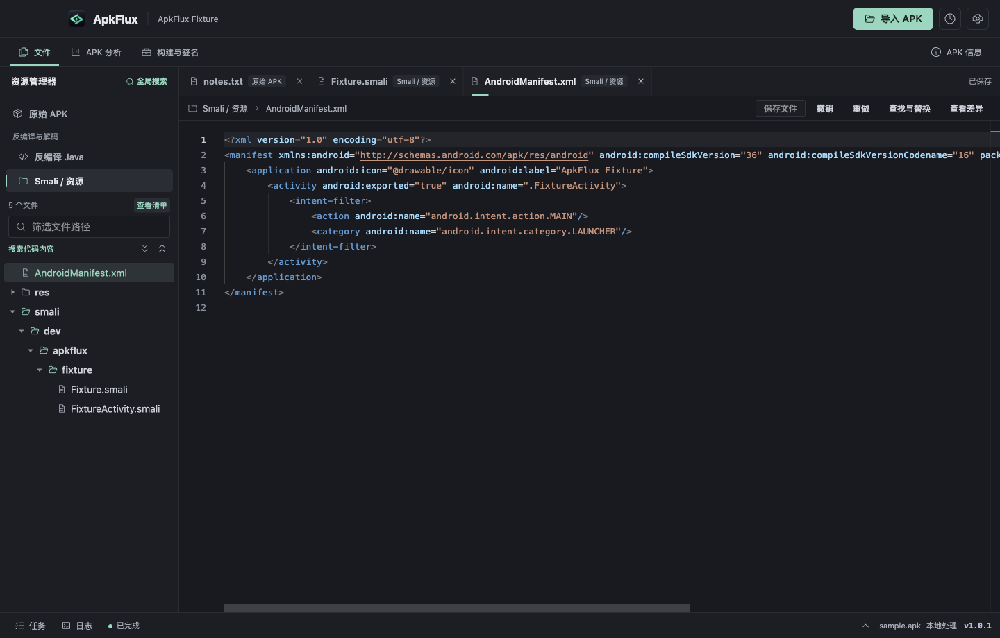

# ApkFlux

ApkFlux 是面向 Apple Silicon Mac 的本地 Android APK 工作台。可浏览包内文件、反编译 Java、编辑 Smali 和资源，并将修改构建为新的签名 APK。

[项目官网](https://wzebbin.github.io/ApkFlux/) · [下载 1.0.1 DMG](https://github.com/wzebbin/ApkFlux/releases/download/v1.0.1/ApkFlux-1.0.1-mac-arm64.dmg) · [发布记录](https://github.com/wzebbin/ApkFlux/releases)



*1.0.1 工作台 · 示例 APK*

## 安装

1. 下载 **1.0.1 Apple Silicon DMG（约 285 MB）**和 [SHA-256 校验文件](https://github.com/wzebbin/ApkFlux/releases/download/v1.0.1/SHA256SUMS.txt)。在下载目录运行 `shasum -a 256 -c SHA256SUMS.txt` 可校验 DMG。
2. 打开 DMG，将 ApkFlux 拖到「应用程序」。免费发布版使用临时签名，首次打开可能出现开发者验证提示。[Apple 的打开说明](https://support.apple.com/zh-cn/102445)
3. 在「设置 → 应用更新 → 查看 GitHub 发布」可获取新版。退出应用后，用新 DMG 中的 ApkFlux 替换旧应用。工作区保存在独立的应用数据目录。

**1.0.1** 内置 ARM64 Java、JADX、Apktool、AAPT2、zipalign、apksigner 和 ADB。安装后可以直接反编译、解码、重建和验签。在「设置 → 外部工具」可查看版本或指定工具路径。SO 分析按需配置 Ghidra。[内置工具说明](docs/bundled-tools.md) · [工具配置步骤](docs/tools.md)

## 第一次打开 APK

1. 点击「导入 APK」、按 ⌘O 或拖入 APK。ApkFlux 将 APK 复制到本地工作区，原始文件保持不变。
2. 在「文件」页浏览「原始 APK」，或点击「查看清单」读取二进制清单。完成 Smali 解码后，可通过同一入口编辑工作副本。
3. 在「反编译 Java」或「Smali / 资源」中点击「开始反编译」或「开始解码」。结果生成后会显示文件树，编辑器标签会标注来源。

## 功能

- **浏览和搜索。** 查看 APK 包信息、签名、DEX、ABI 和 SHA-256。全局搜索支持文件路径和已生成的 Java、Smali、资源内容，点击结果可定位到对应文件或行。
- **编辑和构建。** 多标签保留各自的编辑与滚动位置。支持保存（⌘S）、撤销、重做和查看差异。「构建与签名」使用已保存的工作副本生成独立 APK，执行对齐、签名和验签。
- **分析与报告。** 比较两份 APK 的文件、权限和 SDK。两侧都有解码结果时可以对比代码。报告支持 JSON、HTML 和 CSV。通过 Ghidra 可查看 SO 的反汇编和伪代码。
- **本地工作区。** 按 APK 的 SHA-256 复用工作区。启动时清理超过 30 天未使用的可重建缓存，保留 APK 快照、已保存的编辑和构建产物。

## 从源码启动和打包

使用 Node.js 22.12+（推荐 Node.js 24 LTS）。

```sh
npm ci
npm run dev
```

开发模式使用本机工具。首次启动如需下载 Electron，可运行 `npm exec -- install-electron`。生产构建可用 `npm run build` 后执行 `npm start`。

在 Apple Silicon Mac 上安装 Android SDK Build Tools 37.0.0 和 Platform Tools 后，运行 `npm run dist:mac`，本地 DMG 输出到 `release/`。[构建与发布步骤](docs/build.md)

## 验证

```sh
npm run lint
npm run typecheck
npm test
```

安装 Android SDK Platform、Build Tools 和 JDK 后，可生成签名夹具并做桌面回归。解码、编辑和压力测试还需要可探测的 JADX 和 Apktool，或者使用内置工具的打包版。

```sh
npm run build
npm run fixture
npm run test:desktop
npm run test:decode
npm run test:edit
APKFLUX_FIXTURE_PADDING_MIB=256 APKFLUX_FIXTURE_TEXT_FILES=48 npm run fixture -- test-output/v1-stress.apk
npm run test:stress
```

[桌面验收参数](docs/build.md) · [架构](docs/architecture.md) · [开发进度](docs/progress.md) · [变更记录](docs/changelog.md)
